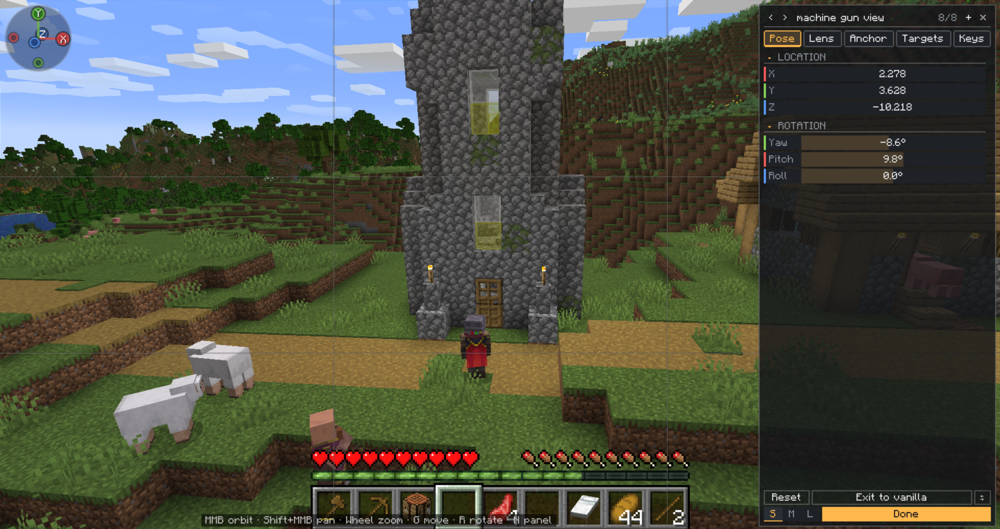
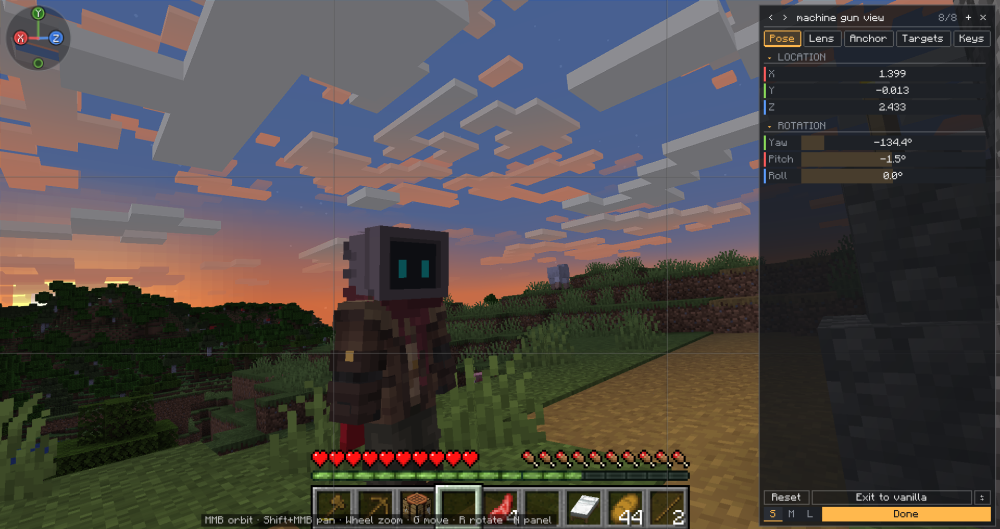
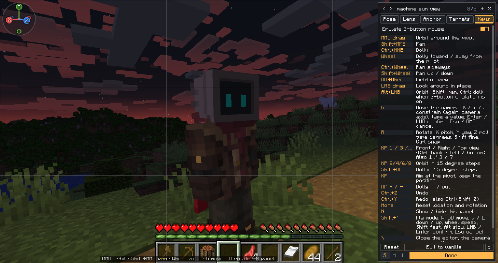
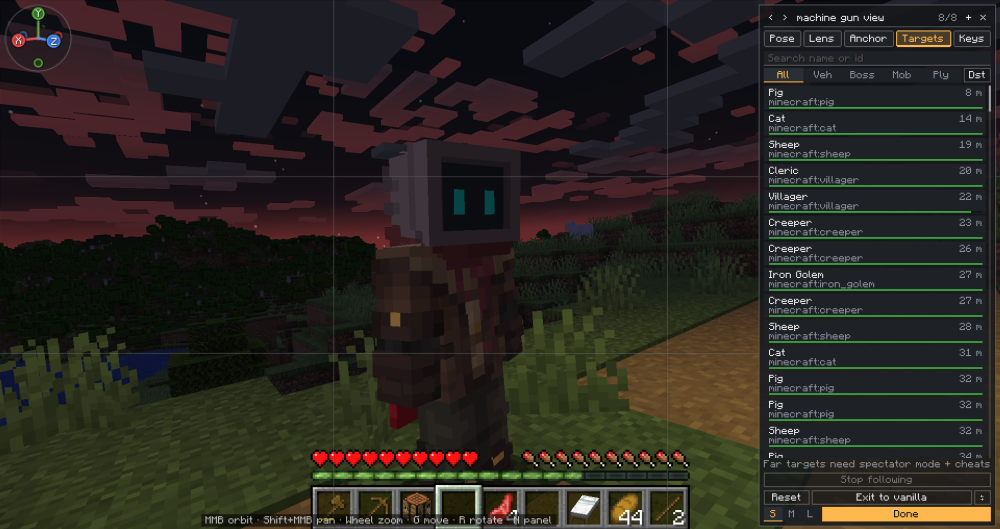

# Simple Perspective Camera

Client-side cinematic camera for Minecraft 1.20.1 (Forge, Fabric) and 1.21.1 (Forge, NeoForge, Fabric). Adds adjustable, lockable third-person perspectives to the F5 cycle, with a live editor and vehicle/target following. Works with [Superb Warfare](https://www.curseforge.com/minecraft/mc-mods/superb-warfare) vehicles (optional).

<table>
  <tr>
    <td align="center"> Pose tab with the composition grid</td>
    <td align="center"> Custom perspective at sunset</td>
  </tr>
  <tr>
    <td align="center"> Keys tab: every editor shortcut</td>
    <td align="center"> Targets tab: entities to follow</td>
  </tr>
</table>

## Features

- Custom perspectives added to the F5 cycle
- Live in-game editor (default key: `\`)
- One-key toggle between the vanilla view and your custom perspectives (default key: `V`)
- Hold Left Alt for free-look: look around with the camera without turning the player
- Anchor to the player or a followed entity, or to the ridden vehicle (the Vehicle anchor only appears when Superb Warfare is installed; old "World" anchors load as Player)
- Per-perspective FOV, smoothing, roll and HUD hiding
- Blender-style viewport controls with undo/redo
- Composition grid over the view while editing (Lens tab, click to cycle): off, thirds (default), grid, center, golden ratio, diagonals, safe area

## Controls

<table>
  <tr><th>Input</th><th>Action</th></tr>
  <tr><td>V</td><td>Toggle Simple Perspective Camera: switch to the last used custom perspective, or back to the previous vanilla view (rebindable)</td></tr>
  <tr><td>Shift+V</td><td>While a custom perspective is active: step to the next perspective</td></tr>
  <tr><td>Hold Left Alt</td><td>Free-look while a custom perspective is active: the mouse rotates the camera only, the player's body and aim stay put. Releasing Alt snaps back (eased by the perspective's smoothing). Not saved, and inactive while a screen is open</td></tr>
  <tr><td>\</td><td>Open the camera editor (rebindable)</td></tr>
</table>

## Editor controls

<table>
  <tr><th>Input</th><th>Action</th></tr>
  <tr><td>MMB / Shift+MMB / Wheel</td><td>Orbit / Pan / Zoom</td></tr>
  <tr><td>G / R</td><td>Move / Rotate (X, Y, Z to constrain)</td></tr>
  <tr><td>Ctrl+Z / Ctrl+Y</td><td>Undo / Redo</td></tr>
  <tr><td>N</td><td>Show / hide panel</td></tr>
  <tr><td>\</td><td>Close the editor; the camera stays on the perspective (same as the Done button)</td></tr>
  <tr><td>Esc</td><td>Close the editor and switch the custom camera off, back to the view you had before (same as Exit to vanilla). Perspectives stay saved. While typing in a field or during G / R / fly, Esc only cancels that</td></tr>
</table>

## Requirements

<table>
  <tr><th>Loader</th><th>Minecraft</th><th>Needs</th><th>Jar</th></tr>
  <tr><td>Forge</td><td>1.20.1</td><td>Forge 47.2.0+, Kotlin for Forge 4.11.0+</td><td><code>simpleperspectivecamera-&lt;version&gt;-forge-mc1.20.1.jar</code></td></tr>
  <tr><td>Fabric</td><td>1.20.1</td><td>Fabric Loader 0.15+, Fabric API, Fabric Language Kotlin 1.11.0+</td><td><code>simpleperspectivecamera-&lt;version&gt;-fabric-mc1.20.1.jar</code></td></tr>
  <tr><td>Forge</td><td>1.21.1</td><td>Forge 52+ (built against 52.1.20), Kotlin for Forge 5.9.0+</td><td><code>simpleperspectivecamera-&lt;version&gt;-forge-mc1.21.1.jar</code></td></tr>
  <tr><td>NeoForge</td><td>1.21.1</td><td>NeoForge 21.1+, Kotlin for Forge 5.9.0+ (NeoForge build)</td><td><code>simpleperspectivecamera-&lt;version&gt;-neoforge-mc1.21.1.jar</code></td></tr>
  <tr><td>Fabric</td><td>1.21.1</td><td>Fabric Loader 0.16+, Fabric API, Fabric Language Kotlin 1.12.3+</td><td><code>simpleperspectivecamera-&lt;version&gt;-fabric-mc1.21.1.jar</code></td></tr>
</table>

> **Note:** other newer Minecraft versions will be added soon.

Superb Warfare is optional at runtime: with it installed, the Vehicle anchor is offered in the editor and a perspective anchored to one of its vehicles follows the vehicle's pitch / roll and the target list shows vehicle health. It is reached by reflection, so the same jar works with or without it (if its API does not match, one warning is logged and the feature turns itself off). Superb Warfare is only published for some loader / version pairs (for example Forge 1.20.1 and NeoForge 1.21.1); on the others the Vehicle anchor simply never appears.

## Build

The project is a [Stonecutter](https://stonecutter.kikugie.dev) multi-loader build with one node per Minecraft version and loader (`versions/<version>-<loader>`). It needs a JDK 21 to run Gradle; Java 17 is downloaded for the 1.20.1 nodes (the 1.21 nodes use Java 21). Forge 1.21 is built with ForgeGradle 7 (ForgeGradle 6 does not run on Gradle 9), NeoForge with ModDevGradle, Fabric with Loom.

<table>
  <tr><th>Command</th><th>Does</th></tr>
  <tr><td><code>./gradlew buildAll</code></td><td>Builds every node (jars in <code>versions/&lt;node&gt;/build/libs</code>)</td></tr>
  <tr><td><code>./gradlew :1.20.1-forge:build</code> / <code>:1.20.1-fabric:build</code> / <code>:1.21.1-forge:build</code> / <code>:1.21.1-neoforge:build</code> / <code>:1.21.1-fabric:build</code></td><td>Builds one node</td></tr>
  <tr><td><code>./gradlew :1.20.1-forge:runClient</code> / <code>:1.20.1-fabric:runClient</code> / <code>:1.21.1-forge:runClient</code> / <code>:1.21.1-neoforge:runClient</code> / <code>:1.21.1-fabric:runClient</code></td><td>Starts a dev client (<code>run/&lt;node&gt;</code>)</td></tr>
</table>

No Superb Warfare jar or extra dependency is needed to build.

## License

GNU General Public License v3.0, see [LICENSE](LICENSE).
